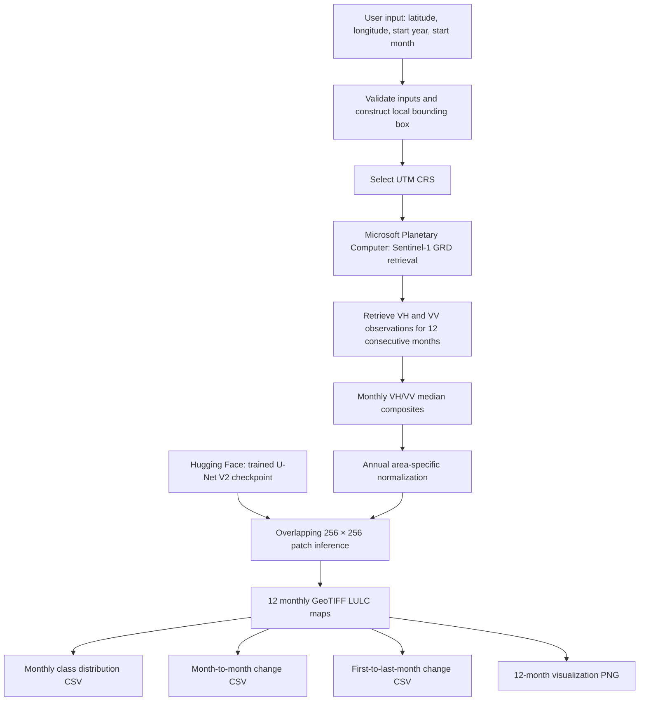

<div align="center">

# Sentinel-1 Chennai LULC Mapping

### Monthly Land Use and Land Cover Prediction Using Sentinel-1 SAR and U-Net V2

**Case-study area:** Chennai, Tamil Nadu, India  
**Demonstration period:** January–December 2021  
**Input data:** Sentinel-1 VH and VV polarization  
**Model:** U-Net V2 semantic segmentation

</div>

---

> **Research note:** This project produces experimental model predictions, not field-verified land-cover maps. Two evaluation exercises are reported separately: spatially held-out validation on S1_AI4LCC training-source data (72.44% overall accuracy and 26.68% mean IoU) and an independent January Chennai comparison with ESA WorldCover 2021 (46.60% overall accuracy and 16.93% mean IoU). These metrics use different reference data and must not be treated as the same experiment. Class performance is uneven, particularly for wetlands and water.

## 1. Project Overview

This project investigates monthly Land Use and Land Cover (LULC) prediction using Sentinel-1 Synthetic Aperture Radar (SAR) imagery and a U-Net V2 semantic segmentation model.

The model was trained using labelled VH and VV SAR samples from the S1_AI4LCC dataset. The trained checkpoint is then used by a Python prototype to process Sentinel-1 GRD observations for a selected location. The prototype accepts a central latitude and longitude, a starting year and a starting month, retrieves imagery for twelve consecutive months, creates monthly VH/VV composites and predicts five LULC classes.

For the Chennai demonstration, the prototype was run at latitude 13.00, longitude 80.22, starting in January 2021. The outputs include twelve GeoTIFF prediction maps, monthly class-distribution statistics, month-to-month and first-to-last-month percentage-point summaries, and a combined twelve-month visualization.

The predictions are experimental. The model was trained on S1_AI4LCC samples from a different geographic region, so transfer to Chennai is affected by domain differences and should be interpreted with the validation limitations described below.

## 2. Project Objectives

1. Prepare labelled Sentinel-1 VH and VV training and validation patches using S1_AI4LCC.
2. Train a five-class U-Net V2 semantic segmentation model.
3. Retrieve Sentinel-1 GRD observations for a user-selected location and 12-month period.
4. Generate monthly median composites for VH and VV.
5. Apply the trained model to monthly composites using overlapping-patch inference.
6. Export twelve georeferenced LULC prediction maps.
7. Calculate the monthly percentage distribution of each predicted class.
8. Calculate month-to-month and first-to-last-month percentage-point differences.
9. Compare the model's Chennai January prediction with ESA WorldCover 2021.
10. Document model performance, class imbalance, and limitations in geographic transfer.

## 3. Study Area and Prototype Inputs

### 3.1 Chennai case study

The main experiment documented in this repository focuses on Chennai, Tamil Nadu, India. The original Chennai study-area bounding box is:

| Boundary | Coordinate |
|---|---:|
| West | 80.15° E |
| East | 80.30° E |
| South | 12.90° N |
| North | 13.05° N |

For the original Chennai raster, the output grid was recorded in EPSG:32644 at a nominal 10-metre resolution, with dimensions of 1,664 × 1,633 pixels. These dimensions describe the recorded Chennai run; they are not fixed for every location entered into the prototype.

### 3.2 Interactive prototype inputs

The published interactive prototype requests:

1. Latitude of the centre of the requested area.
2. Longitude of the centre of the requested area.
3. Starting year.
4. Starting month (1–12).

The script checks that latitude, longitude and month values are within valid ranges. It constructs a local bounding box around the supplied coordinate and selects a UTM coordinate reference system based on the coordinate. The prototype processes the selected start month and the following eleven consecutive months. A period can therefore cross a calendar-year boundary.

The reported Chennai demonstration used latitude 13.00, longitude 80.22, start year 2021 and start month 1.

## 4. Datasets

### 4.1 S1_AI4LCC training dataset

The S1_AI4LCC dataset provides Sentinel-1 SAR inputs and corresponding land-cover labels used to prepare the model's training and validation patches.

- Dataset: https://huggingface.co/datasets/wtr001/S1_AI4LCC
- Input channels used: VH and VV
- Source labels: five land-cover classes, with label 0 treated as unlabelled/invalid

### 4.2 Sentinel-1 GRD deployment imagery

The prototype queries Sentinel-1 GRD observations through the Microsoft Planetary Computer STAC catalogue.

- Data platform: https://planetarycomputer.microsoft.com/
- STAC collection: `sentinel-1-grd`
- Input bands: VH and VV
- Temporal processing: monthly median composites
- Spatial output: 10-metre target resolution in a UTM CRS selected by the prototype

For the successful Chennai January–December 2021 run, 29 scenes were retrieved. The monthly scene counts were:

| Month | Scenes |
|---|---:|
| January | 1 |
| February | 3 |
| March | 2 |
| April | 3 |
| May | 2 |
| June | 3 |
| July | 2 |
| August | 2 |
| September | 3 |
| October | 2 |
| November | 3 |
| December | 2 |

Scene availability varied by month. Therefore, monthly composites were not all based on the same number of source observations.

### 4.3 ESA WorldCover 2021 reference product

ESA WorldCover 2021 was used for a separate January cross-product comparison over Chennai.

- Reference product: https://worldcover2021.esa.int/

The ESA categories were mapped approximately to the project's five classes. ESA tree cover, shrubland and grassland were grouped into the forest/semi-natural class; herbaceous wetland and mangroves were grouped into wetlands; bare and sparse vegetation and other unmatched reference classes were excluded from the reported comparison.

## 5. Land-Cover Classes

The model predicts five output classes. The GeoTIFF products use class IDs 1–5.

| Output class ID | Land-cover class |
|---:|---|
| 1 | Urban areas |
| 2 | Agricultural areas |
| 3 | Forests and semi-natural areas |
| 4 | Wetlands |
| 5 | Water surfaces |

During training, source label IDs 1–5 are remapped to model indices 0–4. Source label 0 is unlabelled/invalid and is converted to the loss ignore index 255. The prediction GeoTIFFs are exported using class IDs 1–5.

## 6. Dataset Preparation and Preprocessing

### 6.1 Source raster and band alignment

The selected S1_AI4LCC training tile is a three-band GeoTIFF. The notebook reads band 1 as VH, band 2 as VV and band 3 as the land-cover label raster. The three bands are read using identical raster windows and pixel offsets when extracting patches. Thus, the image and labels share the same source grid during patch extraction.

The reviewed training code does not separately reproject or resample the label raster. No nearest-neighbour, bilinear or other label-resampling operation is documented in this patch-preparation step. The notebook confirms common-grid extraction from the supplied three-band file, but it does not independently document how the dataset's labels were generated or aligned upstream.

### 6.2 Spatial split and patch extraction

The notebook divides the source raster spatially by columns. The first 80% of columns are assigned to the training region and the remaining 20% to the validation region. Patches that cross the split boundary are not retained.

| Preparation item | Recorded setting |
|---|---:|
| Patch dimensions | 256 × 256 pixels |
| Patch extraction stride | 256 pixels |
| Training fraction of raster columns | 80% |
| Validation fraction of raster columns | 20% |
| Minimum radar-valid fraction per patch | 80% |
| Minimum jointly labelled/radar-valid fraction | 25% |
| Training patches retained | 173 |
| Validation patches retained | 42 |

A patch must contain sufficient finite, non-zero values in both VH and VV and sufficient pixels with valid radar data and a recognised class label. Pixels without a valid class label are excluded from supervised learning.

This is a spatial hold-out within the selected source raster, not a separate geographically independent test dataset.

### 6.3 Label conversion and ignore index

The source label values are handled as follows:

| Source label ID | Model target index | Meaning |
|---:|---:|---|
| 0 | 255 | Unlabelled/invalid; ignored |
| 1 | 0 | Urban |
| 2 | 1 | Agriculture |
| 3 | 2 | Forest/semi-natural |
| 4 | 3 | Wetlands |
| 5 | 4 | Water |

The training pipeline uses `ignore_index=255` in the weighted cross-entropy loss. The validation evaluation excludes pixels carrying this ignore value. This prevents unlabelled pixels from contributing to the loss and reported classification metrics.

### 6.4 Normalization

For training, the notebook calculates channel-wise normalization statistics from the valid labelled training pixels and applies the same statistics to the training and validation arrays.

| Input channel | Training mean | Training standard deviation |
|---|---:|---:|
| VH | 68.72029 | 19.140371 |
| VV | 126.65641 | 35.750645 |

The published prototype separately calculates annual VH and VV statistics from the twelve monthly composites for the selected deployment area and reuses these fixed area-specific statistics across the twelve months. This deployment normalization is not numerically identical to the training-set normalization statistics. The difference is a potential source of training-to-deployment distribution mismatch and should be considered when interpreting transfer performance.

### 6.5 Calibration, dB conversion, speckle filtering and terrain correction

The reviewed project code does not show a separate radiometric-calibration operation, explicit conversion of VH/VV values to decibels, an explicit speckle-filter operation, or a separate terrain-correction operation in the training-patch preparation and published prototype code. The training inputs are supplied S1_AI4LCC GeoTIFF data, while the deployment prototype retrieves Sentinel-1 GRD data through the Planetary Computer.

This statement describes the operations visible in the reviewed project code. It does not make a claim about processing that may have been applied upstream by the dataset or satellite-product provider.

### 6.6 Data augmentation

No explicit image augmentation transform is applied in the final training dataset and DataLoader pipeline reviewed for this experiment. The training DataLoader shuffles patch order, but shuffling is not image augmentation. Rotations, flips or other image transformations are not documented as applied to the final training patches. With a limited number of patches, the absence of augmentation may reduce the variety of spatial patterns and orientations presented to the model and may limit robustness to different locations or acquisition conditions.

### 6.7 Training-label class distribution

The training-label pixel counts recorded during patch preparation are:

| Class | Training label pixels |
|---|---:|
| Urban | 1,344,092 |
| Agriculture | 480,866 |
| Forest/semi-natural | 7,963,965 |
| Wetlands | 114,280 |
| Water | 1,217,494 |

The distribution is imbalanced, with forest/semi-natural labels forming the largest share and wetlands forming a very small share. These are training-label pixel counts, not the predicted class percentages for Chennai.

## 7. U-Net V2 Model Architecture and Training

### 7.1 Architecture

The model is an encoder–decoder U-Net V2-style network for semantic segmentation. The encoder extracts features at progressively coarser spatial scales. The bridge processes the deepest feature representation. The decoder upsamples the features and uses skip connections to recover spatial detail from the encoder.

| Component | Configuration |
|---|---|
| Input channels | 2 (VH and VV) |
| Encoder feature channels | 32, 64, 128 |
| Bridge feature channels | 256 |
| Decoder | Transposed-convolution upsampling |
| Skip connections | Encoder-to-decoder |
| Output channels | 5 |
| Convolution block | Two 3 × 3 convolutions, batch normalization and ReLU |
| Output layer | 1 × 1 convolution |

The model contains 1,926,853 trainable parameters.

### 7.2 Training configuration

| Training item | Recorded value |
|---|---:|
| Training patches | 173 |
| Validation patches | 42 |
| Patch size | 256 × 256 |
| Batch size | 8 |
| Number of epochs | 15 |
| Learning rate | 0.001 |
| Random seed | 42 |
| Optimizer | AdamW |
| Weight decay | 0.0001 |
| Loss function | Weighted cross-entropy |
| Ignore index | 255 |
| Best checkpoint epoch | 13 |
| Best validation loss | 0.8890116711 |

The class weights used for the recorded U-Net V2 training run, in the order urban, agriculture, forest/semi-natural, wetlands and water, were `[0.45, 1.10, 0.60, 2.50, 0.90]`.

### 7.3 Training and validation loss

The notebook records training and validation loss for all 15 epochs. The minimum validation loss was recorded at epoch 13 (0.8890116711), and that checkpoint was saved as `best_sentinel1_unet_v2.pth`.

| Epoch | Training loss | Validation loss |
|---:|---:|---:|
| 1 | 1.2136 | 1.5380 |
| 2 | 0.9617 | 1.3518 |
| 3 | 0.8096 | 1.8318 |
| 4 | 0.7496 | 1.0379 |
| 5 | 0.6487 | 1.1813 |
| 6 | 0.6448 | 1.0417 |
| 7 | 0.6084 | 0.8891 |
| 8 | 0.5846 | 1.1617 |
| 9 | 0.5952 | 1.2665 |
| 10 | 0.5847 | 1.1459 |
| 11 | 0.5910 | 0.9321 |
| 12 | 0.6637 | 1.2333 |
| 13 | 0.5988 | **0.8890** |
| 14 | 0.5366 | 0.9883 |
| 15 | 0.5648 | 1.1748 |

## 8. Model Evaluation on the Spatially Held-Out S1_AI4LCC Validation Region

The U-Net V2 checkpoint selected at epoch 13 was evaluated on the 42 spatially held-out validation patches from the same S1_AI4LCC source raster. The evaluation excluded unlabelled pixels. It is a spatial hold-out validation within the source tile; it is not a separate external test set or geographically independent test dataset.

### 8.1 Overall validation metrics

| Metric | Result |
|---|---:|
| Valid labelled validation pixels | 2,717,640 |
| Overall accuracy | 72.44% |
| Macro F1-score | 34.79% |
| Mean Intersection over Union (mIoU) | 26.68% |

### 8.2 Per-class validation metrics

| Class | Precision | Recall | F1-score | IoU |
|---|---:|---:|---:|---:|
| Urban | 0.31 | 0.22 | 0.26 | 0.1500 |
| Agriculture | 0.55 | 0.73 | 0.63 | 0.4583 |
| Forest/semi-natural | 0.91 | 0.77 | 0.84 | 0.7193 |
| Wetlands | 0.00 | 0.00 | 0.00 | 0.0000 |
| Water | 0.01 | 0.55 | 0.01 | 0.0067 |

The validation support is highly imbalanced. The forest/semi-natural class contains 2,027,392 labelled pixels, while wetlands contains only 501 and water contains 2,542. Overall accuracy therefore does not describe performance equally across all classes. The macro F1-score and per-class IoU show that performance is particularly weak for wetlands and water, and urban classification is also limited.

### 8.3 Confusion matrix

Rows represent reference/actual classes and columns represent predicted classes. Class order: Urban, Agriculture, Forest/semi-natural, Wetlands, Water.

```text
[[  45626   73583   70415       0   13964]
 [   7962  354545   80116       0   40994]
 [  91841  216372 1567076       0  152103]
 [    233      41     206       0      21]
 [    640      52     446       0    1404]]
```

No separate test-set result is claimed in this repository.

## 9. Interactive Monthly Prediction Prototype

### 9.1 User inputs and processing workflow

The published `prototype_prediction.py` requests latitude, longitude, starting year and starting month. It checks the coordinate and month ranges, creates a local bounding box around the supplied coordinate and determines a suitable UTM CRS from the location.

The processing workflow is:

1. Read and validate the user's latitude, longitude, starting year and starting month.
2. Construct the local bounding box and select a UTM CRS.
3. Connect to the Microsoft Planetary Computer STAC catalogue.
4. Search the `sentinel-1-grd` collection for observations covering the twelve-month period.
5. Retrieve VH and VV observations and create a monthly median composite for each month.
6. Calculate fixed annual area-specific VH/VV normalization statistics for the selected twelve-month period.
7. Download the trained U-Net V2 checkpoint from the public Hugging Face model repository.
8. Perform inference using overlapping 256 × 256 patches with a 128-pixel stride.
9. Blend overlapping patch logits using a Hann-derived weighting window.
10. Export twelve monthly GeoTIFF class maps.
11. Calculate monthly class percentages and percentage-point change summaries.
12. Save the combined twelve-month map visualization.

The prototype's monthly percentage and change summaries are calculations from model predictions. They do not independently verify physical land-cover conversion.

### 9.2 Prototype system architecture



### 9.3 Running the prototype

The main project files are available in the GitHub repository. From a terminal opened in the repository directory, install the dependencies:

```bash
python -m pip install -r requirements.txt
```

Run the prototype:

```bash
python prototype_prediction.py
```

On Windows, the Python launcher can also be used:

```cmd
py prototype_prediction.py
```

Enter the requested latitude, longitude, start year and start month when prompted. The prototype requires an internet connection to retrieve Sentinel-1 observations and download the public model checkpoint.

### 9.4 Output location

The prototype saves its prediction products under:

`outputs/Monthly_Predictions/`

The exact output dates follow the selected starting year and month. The Chennai demonstration produced January–December 2021 maps.

## 10. Monthly LULC Prediction Outputs

### 10.1 GeoTIFF maps

The Chennai demonstration generated twelve monthly GeoTIFF files for 2021. The files use the pattern `LULC_YYYY_MM.tif`, with one predicted class raster per month. Each raster stores the five predicted class IDs (1–5) and geospatial metadata.

### 10.2 Monthly class distribution

`Monthly_Class_Distribution.csv` contains the percentage of valid classified pixels assigned to each of the five predicted classes for each month.

For a class \(c\) in a given month, the percentage is:

\[
\text{Class percentage}_{c} =
\frac{\text{Number of valid pixels predicted as class }c}
{\text{Total valid classified pixels}} \times 100
\]

These percentages describe the model's predicted distribution, not an independent measurement of the true land-cover area.

### 10.3 Month-to-month change

`Monthly_Change_Percentage_Points.csv` records the change in predicted class percentage between consecutive months.

\[
\text{Monthly change}_{c,t} =
\text{Percentage}_{c,t} -
\text{Percentage}_{c,t-1}
\]

The values are percentage-point differences (pp), not relative percentage changes.

### 10.4 First-to-last-month change

`Total_First_to_Last_Month_Change.csv` records the difference between the last and first prediction month:

\[
\text{First-to-last change}_{c} =
\text{Percentage}_{c,\text{last}} -
\text{Percentage}_{c,\text{first}}
\]

These differences compare class totals between monthly maps. They do not track individual pixel transitions and cannot, on their own, prove real land-cover conversion.

### 10.5 Twelve-month visualization

`Monthly_LULC_Maps.png` is the combined 3 × 4 monthly visualization generated by the prediction workflow. The higher-resolution report figure, `Monthly_LULC_Maps_Report.png`, is generated separately from the twelve GeoTIFFs by `create_12_month_figure.py`.

## 11. Independent Chennai Comparison with ESA WorldCover 2021

This is a separate evaluation exercise from the spatially held-out S1_AI4LCC validation in Section 8. It compares the January 2021 Chennai prediction with an aligned and approximately regrouped ESA WorldCover 2021 reference raster. ESA WorldCover was not used as the training label source for the U-Net V2 model. This is a cross-product agreement assessment, not field-survey validation.

**Valid comparison pixels:** 2,683,855

### 11.1 Overall Chennai comparison metrics

| Metric | Result |
|---|---:|
| Overall accuracy | 46.60% |
| Macro F1-score | 23.52% |
| Mean IoU | 16.93% |

### 11.2 Per-class Chennai comparison metrics

| Class | Precision | Recall | F1-score | IoU |
|---|---:|---:|---:|---:|
| Urban | 0.77 | 0.64 | 0.6984 | 0.5366 |
| Agriculture | 0.01 | 0.02 | 0.0099 | 0.0050 |
| Forest/semi-natural | 0.35 | 0.69 | 0.4669 | 0.3046 |
| Wetlands | 0.00 | 0.00 | 0.0000 | 0.0000 |
| Water | 0.02 | 0.00 | 0.0006 | 0.0003 |

Agreement was strongest for urban areas and forests/semi-natural areas. Agreement was very weak for agriculture, wetlands and water. The class mapping between ESA WorldCover and the project classes is approximate and affects the interpretation of these metrics.

## 12. Limitations and Interpretation

1. The model was trained on S1_AI4LCC data from a different geographic region than Chennai. This creates a domain-transfer challenge.
2. The training and validation patch counts are limited: 173 training patches and 42 validation patches.
3. Training class distribution is imbalanced, especially for wetlands.
4. No explicit data augmentation is applied in the reviewed final training pipeline.
5. The reviewed project code does not explicitly apply dB conversion, speckle filtering or a separate terrain-correction step.
6. Training normalization statistics and the area-specific normalization used by the prototype are different.
7. ESA WorldCover is an independent satellite-derived reference product, not field-verified ground truth.
8. The ESA-to-project class mapping is approximate.
9. Monthly scene availability varies, and monthly composites can contain different numbers of observations.
10. Seasonal surface conditions and acquisition differences can change SAR backscatter even when the underlying land-cover category does not change.
11. Classification errors can inflate, suppress or reverse the apparent month-to-month changes in class percentages.
12. The monthly change CSVs describe differences in predicted class proportions. They do not establish confirmed pixel-level land-cover transitions.

The Chennai outputs should therefore be treated as experimental predictions and interpreted together with the validation results and class-wise limitations.

## 13. Technologies and Environment

- Python
- PyTorch
- U-Net V2
- Sentinel-1 SAR
- Microsoft Planetary Computer
- STAC / PySTAC Client
- odc-stac
- Rasterio
- NumPy
- Pandas
- Matplotlib
- Hugging Face Hub
- ESA WorldCover 2021

### 13.1 Dependencies

The repository includes `requirements.txt`. Install the listed Python dependencies with:

```bash
python -m pip install -r requirements.txt
```

Use a PyTorch installation compatible with the machine's CPU or CUDA environment. The figure-generation script uses Matplotlib, NumPy and Rasterio.

### 13.2 Accounts, access and connectivity

- **Prototype:** Requires internet access to the Microsoft Planetary Computer STAC service and the public Hugging Face model repository. The reviewed prototype does not request a private API key or token.
- **Training notebook:** The notebook contains Google Earth Engine authentication and project-initialization cells. Those cells require an authenticated Earth Engine account and a valid Google Cloud / Earth Engine project configuration if they are executed. Google Colab and Google Drive are used in the notebook workflow.
- **Dataset and model:** The S1_AI4LCC dataset and trained checkpoint are hosted on Hugging Face.

## 14. Repository Structure

```text
Sentinel1-Chennai-LULC-2021/
│
├── README.md
├── deep_learning.ipynb
├── prototype_prediction.py
├── create_12_month_figure.py
├── requirements.txt
│
└── outputs/
    └── Monthly_Predictions/
        ├── LULC_2021_01.tif
        ├── LULC_2021_02.tif
        ├── LULC_2021_03.tif
        ├── LULC_2021_04.tif
        ├── LULC_2021_05.tif
        ├── LULC_2021_06.tif
        ├── LULC_2021_07.tif
        ├── LULC_2021_08.tif
        ├── LULC_2021_09.tif
        ├── LULC_2021_10.tif
        ├── LULC_2021_11.tif
        ├── LULC_2021_12.tif
        ├── Monthly_Class_Distribution.csv
        ├── Monthly_Change_Percentage_Points.csv
        ├── Total_First_to_Last_Month_Change.csv
        ├── Monthly_LULC_Maps.png
        └── Monthly_LULC_Maps_Report.png
```

The listed monthly TIFF names illustrate the Chennai 2021 demonstration. For a different user-selected start period, the year/month portions of the raster filenames follow the requested prediction dates.

## 15. Project Resources

**GitHub Repository:**  
https://github.com/Madhumitha0109/Sentinel1-Chennai-LULC-2021

**Training Dataset:**  
https://huggingface.co/datasets/wtr001/S1_AI4LCC

**Training Notebook:**  
https://github.com/Madhumitha0109/Sentinel1-Chennai-LULC-2021/blob/main/deep_learning.ipynb

**Prototype Code:**  
https://github.com/Madhumitha0109/Sentinel1-Chennai-LULC-2021/blob/main/prototype_prediction.py

**Trained Model Repository:**  
https://huggingface.co/Madhumitha01/Sentinel1-Chennai-LULC-UNetV2

**Model Weights:**  
https://huggingface.co/Madhumitha01/Sentinel1-Chennai-LULC-UNetV2/blob/main/best_sentinel1_unet_v2.pth

**Monthly Prediction Outputs:**  
https://github.com/Madhumitha0109/Sentinel1-Chennai-LULC-2021/tree/main/outputs/Monthly_Predictions

**Requirements:**  
https://github.com/Madhumitha0109/Sentinel1-Chennai-LULC-2021/blob/main/requirements.txt

---

<div align="center">

**Sentinel-1-Based Monthly Land Use and Land Cover Mapping**

Chennai, Tamil Nadu, India | 2021 case study

</div>


### 11.3 Separate transfer experiment: France-trained checkpoint applied to Chennai

A later transfer experiment was conducted using the epoch-13 U-Net V2 checkpoint trained on S1_AI4LCC data. The checkpoint was applied to the January 2021 Chennai VH/VV raster using tiled inference. This is a separate experiment from the earlier prototype comparison in Section 11.1; its metrics must not be substituted for or combined with the earlier 46.60% overall accuracy / 16.93% mIoU result.

The transfer prediction used annual Chennai VH/VV normalization statistics calculated from the twelve 2021 monthly composites (VH mean -18.05117, VH standard deviation 5.2670507; VV mean -8.825205, VV standard deviation 6.6482267). Pixels with no valid monthly observations were treated as invalid. The January prediction was compared with the aligned ESA WorldCover 2021 raster.

**ESA-to-model grouping used in this transfer experiment:**

| ESA WorldCover class ID | ESA class | Project class |
|---:|---|---|
| 50 | Built-up | Urban |
| 40 | Cropland | Agriculture |
| 10 | Tree cover | Forest/semi-natural |
| 20 | Shrubland | Forest/semi-natural |
| 30 | Grassland | Forest/semi-natural |
| 60 | Bare/sparse vegetation | Forest/semi-natural |
| 90 | Herbaceous wetland | Wetlands |
| 80 | Permanent water bodies | Water |

This grouping is approximate. In particular, ESA class 60 (bare/sparse vegetation) is grouped with forest/semi-natural for this experiment. This differs from the earlier comparison described in Section 11.1, where bare/sparse vegetation and unmatched classes were excluded. The two comparisons therefore use different reference mappings and are not directly comparable.

**Transfer experiment metrics:**

| Metric | Result |
|---|---:|
| Evaluated pixels | 2,702,120 |
| Overall accuracy | 59.28% |
| Macro F1-score | 39.02% |
| Mean IoU | 28.94% |

| Class | Precision | Recall | F1-score | IoU |
|---|---:|---:|---:|---:|
| Urban | 0.79 | 0.53 | 0.64 | 46.82% |
| Agriculture | 0.02 | 0.02 | 0.02 | 1.21% |
| Forest/semi-natural | 0.41 | 0.82 | 0.55 | 37.61% |
| Wetlands | 0.00 | 0.00 | 0.00 | 0.00% |
| Water | 0.91 | 0.63 | 0.74 | 59.09% |

Rows in the confusion matrix below are ESA reference classes and columns are model predictions. Class order: Urban, Agriculture, Forest/semi-natural, Wetlands, Water.

```text
[[ 690942   1339 595172      0   5841]
 [  21756   3259  96329      0   9817]
 [  96365   8731 516786      0  10789]
 [   1907   1440   6710      0  11182]
 [  62516 127229  43217      0 390793]]
```

The transfer prediction raster uses model indices 0–4 and 255 for nodata, unlike the prototype's monthly GeoTIFF export convention of class IDs 1–5. Keep these products and legends distinct when interpreting or displaying them. The transfer results show useful agreement for urban, forest/semi-natural and water pixels, but very weak agriculture agreement and no correctly predicted wetland pixels. These results indicate substantial geographic/domain-transfer limitations and are not field-validated accuracy.

Supporting transfer-evaluation files are stored in `outputs/Transfer_Evaluation/`:
- `Chennai_Transfer_Evaluation.json`
- `Chennai_Transfer_Confusion_Matrix.csv`
- `Chennai_Transfer_Class_IoU.csv`
- `Chennai_Transfer_Visualization.png`

